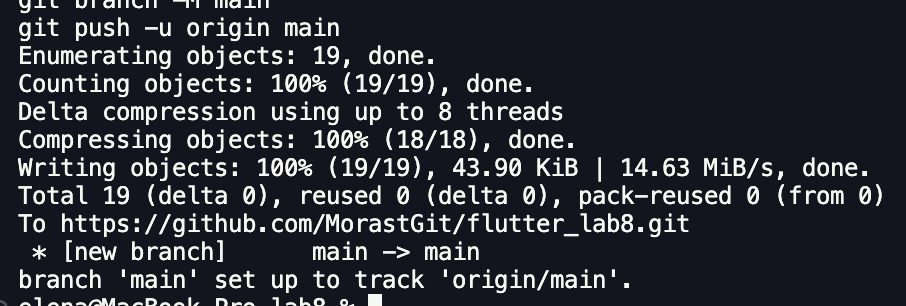

# Лабораторная работа №8. Асинхронность в Dart и Flutter. Создание приложения «Фото дня»


Козубенко Елена ИСП-241  

Показывает случайное фото по выбору пользователя — собака (через сетевое API dog.ceo) или пейзаж (случайное изображение с picsum.photos). В проекте также реализован режим загрузки локальных изображений из ассетов.

## Стек и версии

- **Flutter:** 3.x (проверить командой `flutter --version`)
- **Dart:** 3.x (идёт в комплекте с Flutter)
- **Платформа:** Web (Chrome)
- **Пакеты:** `http` — HTTP-запросы к API (в pubspec.yaml: `http: ^1.2.0`)

## Скриншот приложения

| Картинка | Описание |
| --- | --- |
|  | Стартовый экран выбор «Собаки / Пейзаж» |
|  | Во время загрузки |
|  | Загруженное фото |

## Как запустить
```bash
# 1. Клонировать репозиторий
git clone <url>
# 2. Перейти в папку проекта
cd photo_of_the_day
# 3. Установить зависимости
flutter pub get
# 4. Запустить в Chrome
flutter run -d chrome
```

## Что изучили

1. **Асинхронность в Dart** — работа с `Future`, `async/await` как выполнить сетевой запрос, не замораживая UI, и что происходит во время ожидания ответа.
2. **Управление состоянием через setState()** — как изменение полей класса State связано с перерисовкой виджета
3. **Структура StatefulWidget** — разделение неизменяемого виджета (`PhotoPage`) и его изменяемого состояния (`_PhotoPageState`), жизненный цикл State.
4. **Работа с HTTP в Flutter** — пакет `http`, разбор JSON через `dart:convert` (`jsonDecode`), обработка кодов ответа и ошибок через `try/catch`.

## Ответы на вопросы

### 1. Что такое `Future<T>`? Чем отличается от обычного возвращаемого значения?

`Future<T>` — это объект-«обещание» значения типа `T`, которое появится **в будущем**, после завершения асинхронной операции (сетевой запрос, чтение файла, задержка по таймеру).

обычный тип (`String`, `int`) содержит готовый результат уже в момент возврата — вызов «стоит на месте», пока не получит его. `Future<T>` возвращается **мгновенно**, но сам результат в нём ещё отсутствует: он появится позже — успешно или с ошибкой. Это позволяет не блокировать поток выполнения: UI продолжает перерисовываться, пока запрос идёт.

### 2. Что делает `await`? Блокирует ли он весь поток выполнения?

`await` приостанавливает выполнение **текущей асинхронной функции** до тех пор, пока `Future` справа не завершится, и «распаковывает» его результат (или выбрасывает ошибку, если Future завершился с исключением).

Весь поток выполнения он **не блокирует**. В однопоточном Dart event loop  на время ожидания управление возвращается наружу, и event loop обрабатывает другие события. Поэтому экран продолжает отзываться. Блокируется только код ниже `await` внутри этой же функции — он продолжится после завершения операции. Если убрать `await`, функция продолжит выполняться сразу, не дождавшись результата.

### 3. Зачем `setState()` вызывается дважды в `_fetchPhoto()`?

Потому что у операции есть **два разных состояния, которые нужно показать пользователю**:

1. **Первый вызов (начало)** — переводит UI в состояние «загрузка»: `_isLoading = true`, сбрасываются старые `_photoUrl` и `_errorMessage`. Благодаря этому сразу показывается `CircularProgressIndicator`.
2. **Второй вызов (завершение)** — фиксирует результат: успешный (`_photoUrl = ..., _isLoading = false`) или ошибку (`_errorMessage = ..., _isLoading = false` в `catch`).

### 4. Почему кнопке передаётся `_fetchPhoto` без скобок, а не `_fetchPhoto()`?

`onPressed` — это **ссылка на функцию** кнопка должна сама вызвать её потом, когда пользователь нажмёт. Передавая `_fetchPhoto`, мы отдаём кнопку саму функцию как значение.

Если написать `_fetchPhoto()`, функция будет **вызвана немедленно прямо во время построения виджета** в `build()`, а в `onPressed` попадёт её результат


### 5. Чем `Image.network()` отличается от `Image.asset()`?

| | `Image.asset()` | `Image.network()` |
| --- | --- | --- |
| Источник | Файл, вшитый в приложение (бандл) | Файл, скачиваемый по URL из интернета |
| Скорость появления | Мгновенно — файл уже на устройстве | Зависит от сети; нужна загрузка |
| Подготовка | Файл должен существовать в проекте и быть объявлен в `pubspec.yaml` (секция `assets:`) | Ничего объявлять не надо, но нужен интернет |
| Ошибки | «Unable to load asset», если файл отсутствует/не объявлен или путь с опечаткой | Ошибки сети, 404 — обрабатываются через `errorBuilder`/`frameBuilder` |
| Типичные применения | Иконки, иллюстрации, локальные обои | Фото из API, аватарки, любой удалённый контент |

По API виджеты одинаковы (общие параметры `fit`, `width`, `height` и т.д.), различается только **источник данных**: ассет читается из корневого бандла (`rootBundle`), network — через HTTP-запрос во время работы приложения. В нашем проекте сетевые фото (dog.ceo, picsum) — это `Image.network()`, а резервный режим с локальными картинками — `Image.asset()`.
